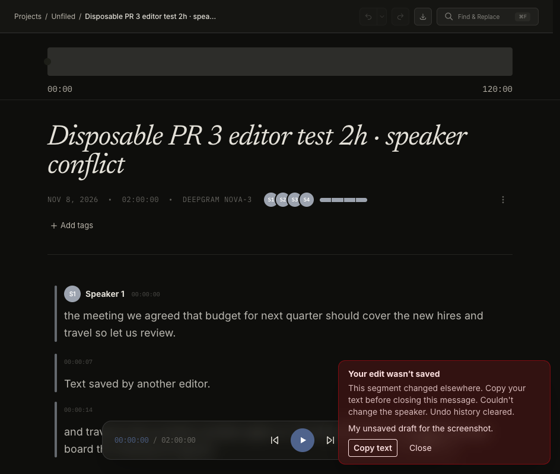

# Editor performance final integration

The application under review is integration tip `2d7c7a2`, including PRs #154,
#158, #159 and the Whole Word follow-up in #160.

## First-card benchmark

Each sample measures from full document navigation start to the first segment
card entering the DOM. Three isolated Next.js production builds used the same
local Supabase instance, package lock, test account and named fixtures. Chrome
156.0.8078.80 ran headless at 1,440 × 900, DPR 1 and 1× CPU. The browser used a
synthetic audio URL for all three builds. Each fixture and revision had two
warm-up navigations and nine measured navigations. Revision order rotated by
round. Segment, word, transcript and speaker checksums matched before and
after the run.

| Production revision | 2 h / 20,000 words, median (range) | 10 h / 100,000 words, median (range) |
| --- | ---: | ---: |
| Original baseline `9302cc2` | 185.6 ms (128.9–307.9) | 338.1 ms (214.4–2,593.1) |
| Pre-PR 3 `9d5e0ed` | 205.4 ms (133.4–323.0) | 341.4 ms (211.3–1,032.1) |
| Final integration `2d7c7a2` | 172.8 ms (128.2–304.5) | 359.8 ms (204.4–1,932.3) |

The final build had the lowest 2-hour median in this run. The 10-hour medians
were within 22 ms of one another, with substantial variation across runs.
Median encoded word responses fell from 4.16 MB to 3.08 MB on the 2-hour
fixture and from 20.97 MB to 15.57 MB on the 10-hour fixture, about 26% on each.
All revisions used two plain segment requests for the 2-hour fixture and six
for the 10-hour fixture, including the empty terminal page. The snapshot RPC
serves focus refresh and repair.

Measured samples in round order, milliseconds:

| Revision | Fixture | Samples |
| --- | --- | --- |
| `9302cc2` | 2 h | 261.4, 185.6, 128.9, 228.1, 161.0, 174.7, 216.8, 135.5, 307.9 |
| `9302cc2` | 10 h | 264.4, 214.4, 240.8, 338.1, 2,593.1, 643.2, 452.0, 373.7, 239.8 |
| `9d5e0ed` | 2 h | 133.4, 156.0, 205.4, 323.0, 145.1, 217.2, 313.0, 177.2, 216.9 |
| `9d5e0ed` | 10 h | 257.7, 211.3, 481.4, 1,032.1, 259.2, 990.2, 893.7, 331.3, 341.4 |
| `2d7c7a2` | 2 h | 173.7, 128.2, 143.0, 172.8, 156.7, 304.5, 189.3, 151.8, 281.4 |
| `2d7c7a2` | 10 h | 349.3, 204.4, 303.3, 359.8, 1,932.3, 1,521.7, 506.0, 492.3, 296.6 |

## Integration checks

- Full Jest passed with 229 suites, 3,055 tests and seven snapshots. The run
  reported listener-limit and delayed-exit warnings and exited successfully.
- Typecheck, the isolated local production build, and whitespace checks passed.
  Lint reported zero errors and 60 warnings.
- Chrome on the production build checked playback on the named 2-hour recording,
  and typing/save/undo, Find/Replace/undo, speaker picker Escape and focus return,
  split/undo, guarded leave and reopening on a disposable copy. The two-tab
  conflict check confirmed that the editor displays the saved text and retains
  the full local draft for Copy until Close dismisses the toast.
- A sign-out initiated from the editor on the configured development origin
  flushed a pending draft, returned to sign-in, and stopped the stale production
  editor in the other tab. A live switch to a second WorkOS identity remains
  outside this run.
- A read-only local database check returned all 1,000 snapshot rows to the
  fixture owner, denied anonymous execution and returned no snapshot to an
  unrelated subject. The disposable copy was removed. The two named fixtures
  matched the benchmark checksums after the smoke checks.

Conflict recovery in the PR 3 browser review, using a disposable transcript:

## Coverage gaps

- Native macOS Japanese IME in Safari and Chrome remains deferred. PR 2 records
  the replayed Safari and Chrome composition coverage.
- Hosted rollout still requires the editor snapshot migration and hosted
  environment validation.

Earlier results cover [PR 1](editor-performance-pr1-results.md),
[PR 2](editor-performance-pr2-results.md), and
[PR 3](editor-performance-pr3-results.md).
